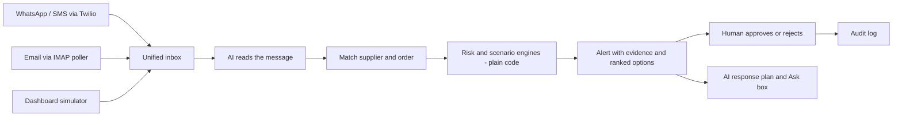

# Lifeline: agentic AI for resilient supply chains

> From disruption to decision. One AI agent reads supplier and delivery-partner messages from WhatsApp, SMS and email, works out what the delay will cost, compares recovery options, drafts the response, and leaves the final call to a human.

Built for the **SAP Hackathon 2026** (theme: *agentic AI that senses, adapts and recovers in real time*). Status: **working prototype running on sample data**.


## The problem

A delay usually arrives as an unstructured message ("shipment will be 8 days late, vehicle breakdown"). Someone has to read it, find the order, check stock, estimate the damage and decide, by hand, while the stock runs down. Lifeline turns that chain into seconds of work and keeps a person in control.

## What it does

- **Senses:** one inbox for WhatsApp and SMS (Twilio webhook), email (IMAP poller) and a built-in simulator.
- **Understands:** an AI model extracts intent, delay, reason and order number from messy, multilingual text, with a confidence score. Doubtful messages go to *needs review* instead of triggering action.
- **Calculates:** plain code (not the AI) computes days of stock cover, stock-out date, gap, revenue at risk and a supplier risk score.
- **Adapts:** ranks recovery options that differ per situation (backup partner, express transport, split shipment, replacement vehicle, re-sequencing production, and more).
- **Recovers:** drafts an action plan, a message to the partner and questions to ask, grounded in verified numbers and the company's own past actions (`data/playbook.csv`). A human approves; everything is audit-logged.
- **Answers questions:** a free-form Ask box answers from live orders, stock and alerts, and flags any figure that is not in the data.

## How it works



**Design principles**

1. *AI reads, code calculates, humans decide.* The model never does arithmetic on money or dates and cannot approve anything.
2. *Every AI output is validated.* Model replies are parsed defensively, cross-checked against a rule-based reader, and disagreements are sent to a human.
3. *It works without AI.* If no model is available, a rule-based reader and rule-based plans take over.
4. *Slow models are safe.* Plans and answers run as background jobs that the dashboard polls, so a slow local model cannot hit a timeout.

## Tech stack

Python, FastAPI, Uvicorn, SQLite, vanilla HTML/CSS/JavaScript. AI through any OpenAI-compatible endpoint (default: a local **Ollama** model, `qwen2.5:3b`), with optional Anthropic and SAP Generative AI Hub providers. Twilio (WhatsApp/SMS webhooks), IMAP (email), Cloudflare quick tunnels for live webhooks.

## Quick start (Windows PowerShell)

```powershell
# one-time: install Python 3.12 and Ollama, then
ollama pull qwen2.5:3b
cd lifeline
powershell -ExecutionPolicy Bypass -File .\run_local_ai.ps1
```

Open http://localhost:8000. No model? Run without AI:

```powershell
python -m pip install -r requirements.txt
cd backend
python -m uvicorn main:app --reload
```

Smoke test without the web server: `python backend/demo_cli.py`.

## Configuration

| Variable | Purpose |
|---|---|
| `LIFELINE_LLM` | `mock` (rules only, default), `openai` (any OpenAI-compatible server), `anthropic`, `sap` |
| `LLM_BASE_URL`, `LLM_MODEL`, `LLM_API_KEY`, `LLM_TIMEOUT` | For `openai` (defaults target local Ollama) |
| `LIFELINE_PASSWORD` | Optional login for the dashboard and API (webhooks and `/api/health` stay open) |
| `TWILIO_AUTH_TOKEN`, `LIFELINE_PUBLIC_URL` | Optional Twilio signature check |
| `IMAP_HOST`, `IMAP_USER`, `IMAP_PASSWORD` | For `backend/channels/email_poll.py` |
| `LIFELINE_DB`, `LIFELINE_TODAY` | Database path; fixed demo date (`real` uses today) |

## Live demo messages

Reset the demo first (sidebar button). Examples (partners are *All India Cargo* and *DHL* in the sample data):

| Message | Expected |
|---|---|
| `AIC-HYP-20261051 will be 8 days late, vehicle breakdown` | Critical alert, backup partner recommended |
| `AIC-HYP-20261052 delayed, will update soon` | Needs review (no length given) |
| `DHL-HYP-20261053 will be 4 days late` (sent as All India Cargo) | Refused: order belongs to another partner |
| `AIC-HYP-20261052 will be 1 day late` | Info only, stock covers it |

## API

15 REST endpoints under `/api` (`health`, `summary`, `orders`, `suppliers`, `inventory`, `messages`, `alerts`, `alerts/{id}`, `ingest`, `alerts/{id}/decision`, `alerts/{id}/plan`, `ask`, `jobs/{id}`, `audit`, `reset`) and two webhooks (`/webhooks/twilio`, `/webhooks/email`). Interactive docs at `/docs`.

## Project structure

```
backend/   main.py (API) agent.py (pipeline) llm.py (all AI calls) risk.py scenarios.py db.py jobs.py config.py
           channels/ (email_poll.py, twilio_sig.py)  prompts/plan_system.md
frontend/  index.html app.js styles.css
data/      suppliers.csv parts.csv orders.csv inventory.csv playbook.csv
tools/     convert_complaints.py  start_tunnel.ps1
```

## Data

The orders, carriers, delay reasons, statuses and the playbook come from a hypothetical delivery-delay complaints dataset (50 consignments, 2 carriers, 10 delay reasons). Items, quantities, dates, stock levels, costs, contact details and the two alternate carriers are **generated sample data**. Scenario parameters in `backend/config.py` are placeholder assumptions to be replaced with real contract values. `tools/convert_complaints.py` rebuilds the CSV files from the workbook.

## Limitations and roadmap

- Prototype on SQLite with a single instance and no user accounts; add authentication, a production database and a job queue before real use.
- Messages are not sent back to partners yet; plans are drafts to copy.
- No formal test suite or accuracy benchmark yet. The 50 labelled complaints are a natural test set.
- SAP integration is **designed, not live**: the data model maps to ERP purchase-order and stock data, and an SAP Generative AI Hub provider exists in code but is unverified. Planned: HANA Cloud storage, live ERP feeds, approved WhatsApp Business templates, guarded auto-execution for pre-approved actions.

## Security notes

Keep service keys, `.env` files and the database out of Git (see `.gitignore`). Replace the sample phone numbers and emails in `data/suppliers.csv` before sharing a repository publicly.
